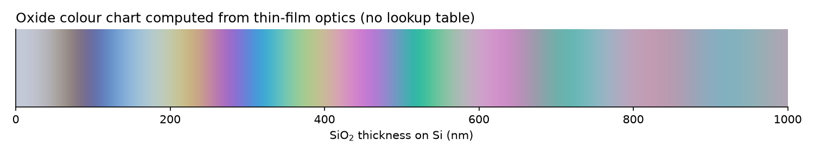
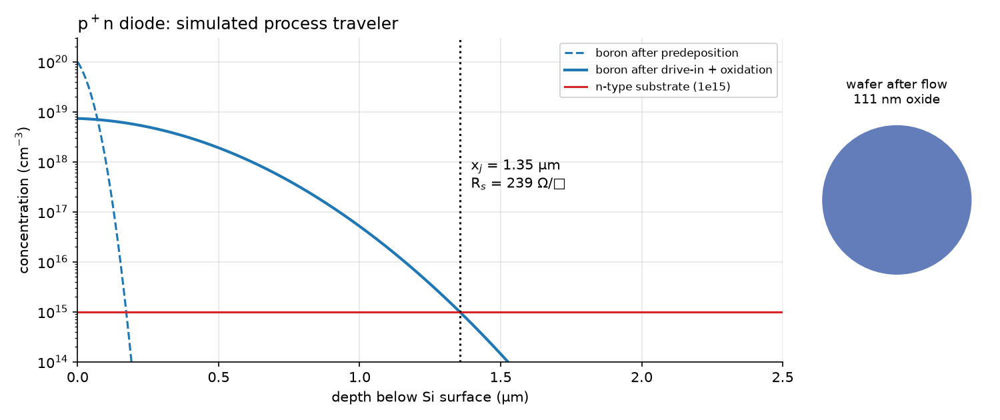
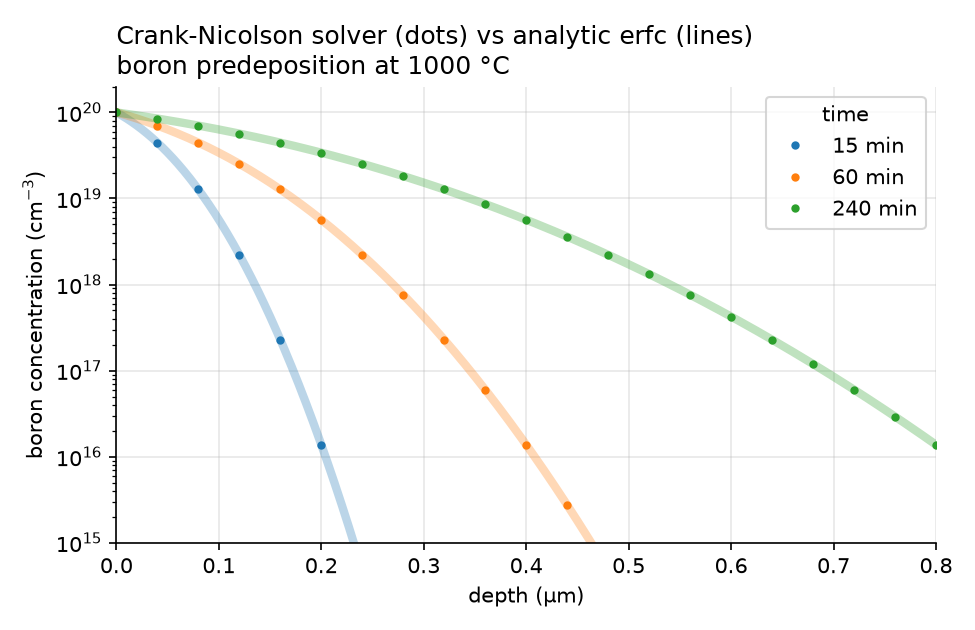
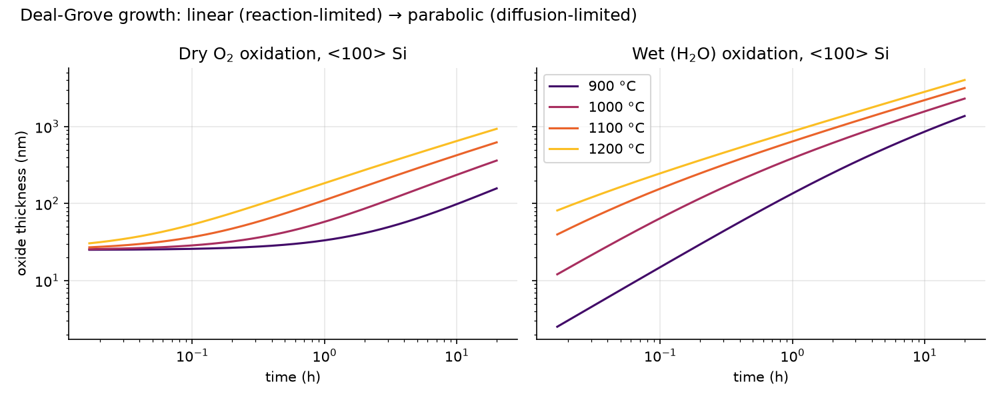
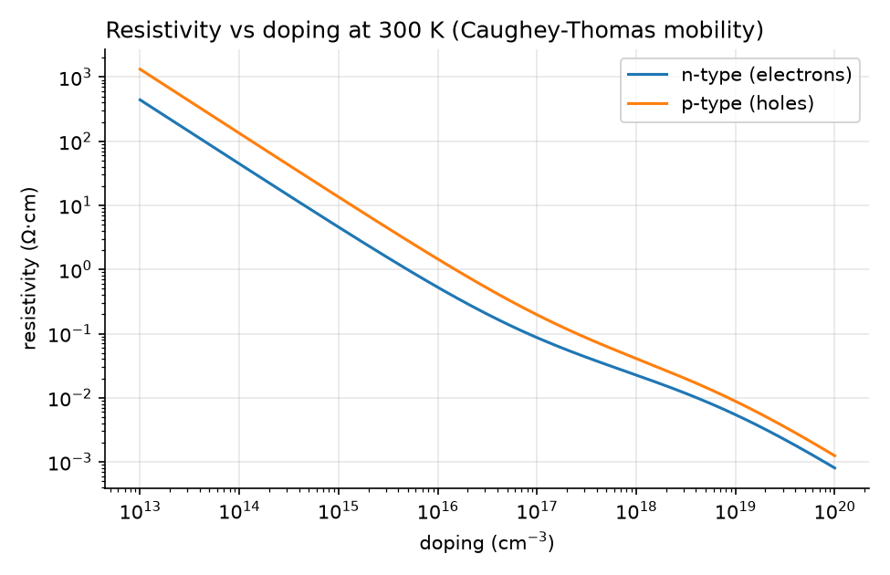

# fabsim: a silicon front-end process simulator

[](https://github.com/DSTX28/fabsim/actions/workflows/tests.yml)
&nbsp;**[▶ Try the interactive furnace in your browser](https://dstx28.github.io/fabsim/)**

Python models of the core steps in a silicon fab: **thermal oxidation, dopant predeposition and drive-in,
ion implantation, sheet resistance and oxide colour**. Each model is **validated against published data or an
exact analytic solution** (32 automated tests run on every commit).



*The colour of an oxidised wafer, computed from thin-film interference optics and CIE colour science, with
no lookup table. It reproduces the standard thermal-oxide colour chart (Pliskin & Conrad) to within ~10 nm,
e.g. royal blue at 120 nm, gold at 210 nm, red-violet at 270 nm.*

## What it does

Run a wafer through a process traveler and get the resulting doping profile, junction depth, sheet resistance
and oxide thickness, the same numbers a fab would measure with a four-point probe, ellipsometer and SIMS.

```python
from fabsim import Wafer

w = Wafer(substrate="n", background=1e15)            # n-type <100> wafer, 1e15 cm^-3
w.oxidize(1000, 90, ambient="wet").strip_oxide()     # sacrificial oxide, HF strip
w.predeposit("B", 950, 30, surface_conc=1e20)        # boron predeposition
w.oxidize(1100, 60, ambient="dry")                   # drive-in under a growing oxide
print(w.report())
```
```
Oxide thickness:   111 nm (#637dba)
Junction depth:    1.355 um
Sheet resistance:  239.4 ohm/sq
Surface doping:    7.38e+18 cm^-3 (p-type)
```



Every step diffuses **all** dopants already in the wafer at that step's temperature, so later high-temperature
steps move earlier junctions, as they do in a real flow. Oxidation consumes 0.44 µm of Si per µm of oxide grown.

## Models and how they are validated

| Step | Model | Validation (see [`tests/`](tests/test_models.py)) |
|---|---|---|
| Thermal oxidation | Deal-Grove linear-parabolic, dry & wet, <100>/<111> | Rate constants within 25 % of Deal & Grove's (1965) measured tables, 800–1200 °C; linear and parabolic limits; split steps equal one long step |
| Predeposition | Fick's 2nd law, numerical (Crank-Nicolson) with fixed surface concentration | Matches the analytic erfc solution to < 0.2 % of C<sub>s</sub> |
| Drive-in / anneal | Same solver, zero-flux surface | Matches the analytic half-Gaussian to < 1 %; dose conserved to 0.1 % |
| Ion implantation | Gaussian with R<sub>p</sub>, ΔR<sub>p</sub> from LSS range tables | Dose integrates exactly; peak at R<sub>p</sub>; As < P < B range ordering |
| Mobility / resistivity | Caughey-Thomas, 300 K | Within 20 % of the Irvin curves for n and p, 10<sup>15</sup>–10<sup>18</sup> cm<sup>-3</sup> |
| Sheet resistance | R<sub>s</sub> = 1 / (q∫μ(N)\|N<sub>net</sub>\|dx), four-point probe factor π/ln2 | Uniform layer reduces exactly to ρ/t |
| Oxide colour | Airy thin-film reflectance → CIE 1931 XYZ → sRGB | Bare Si reflects 35 %; quarter-wave minimum at λ/4n; hues match the standard colour chart |



<p float="left">
  
  
</p>

## Limitations (what a TCAD tool like Sentaurus does that this doesn't)

- Diffusivities are **intrinsic**: no concentration-dependent, oxidation-enhanced or transient-enhanced diffusion,
  so heavily doped profiles diffuse too little.
- No dopant **segregation** at the Si/SiO<sub>2</sub> interface (in reality boron is pulled into a growing oxide and phosphorus piles up beneath it).
- Implants are single Gaussians (no channelling tails or Pearson-IV skew) and the oxide is treated as transparent to ions.
- 1-D only: no lateral diffusion under mask edges.
- Dry-oxidation thin-film regime handled with Deal & Grove's 25 nm effective-initial-oxide convention.

## Run it

```bash
pip install -e ".[dev]"
pytest -v                          # 32 validation tests
python examples/make_figures.py    # regenerate figures/
```

The [browser version](https://dstx28.github.io/fabsim/) (in [`docs/`](docs/)) re-implements the oxidation,
colour and diffusion models in plain JavaScript, so it runs with no install.

## References

- B. E. Deal & A. S. Grove, *J. Appl. Phys.* **36**, 3770 (1965): oxidation kinetics
- R. B. Fair, in *Impurity Doping Processes in Silicon* (1981): intrinsic diffusivities
- J. F. Gibbons, W. S. Johnson & S. W. Mylroie, *Projected Range Statistics* (1975): implant ranges
- D. M. Caughey & R. E. Thomas, *Proc. IEEE* **55**, 2192 (1967): mobility model
- I. H. Malitson, *JOSA* **55**, 1205 (1965); D. E. Aspnes & A. A. Studna, *PRB* **27**, 985 (1983): optical constants
- C. Wyman, P.-P. Sloan & P. Shirley, *JCGT* **2**(2) (2013): analytic CIE colour-matching functions
- W. A. Pliskin & E. E. Conrad, *IBM J. Res. Dev.* **8**, 43 (1964): oxide colour chart
- R. C. Jaeger, *Introduction to Microelectronic Fabrication*; J. D. Plummer et al., *Silicon VLSI Technology*

---
Daniel Shaheen · Electrical Engineering (Micro & Nano Devices), Texas State University · MIT License
